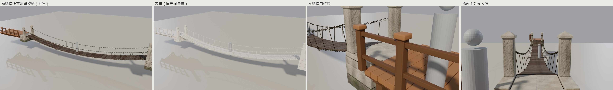

| 項目 | 內容 |
|---|---|
| 誰做的 | A（Johnnnny0823） |
| 工作包 | docs/execution/2026-11-05/A-48h-mountain-city-architecture.md（MC02；併入 docs/execution/2026-11-08/A-80h-mountain-city.md 第一部分） |
| ID | MC02-24M、MC02-12M 索橋 |
| 分支／PR | art/a-1105-mc02-rope-bridge ／ #98 |
| 版本 | v001 |
| 狀態 | Exported；Imported：見「驗收紀錄」的 Unity 6000.3.28f1 檢查；In-game Verified：未驗 |
| 素材來源 | 原創。建模腳本 `art/source/mc02-rope-bridge/build_mc02.py`，沿用 MC01（#80）的建模函式與共用貼圖、TX04（#90）的石塊函式；三視圖用 Codex CLI 生成，存 `art/references/MC02-*/` |

# MC02 索橋

兩座可走的鐵鏈索橋，長 24 m 和 12 m，橋面寬 1.6 m，下垂 1.5 m（24 m）和 0.45 m（12 m），兩端同高。兩座造型相同，只差長度，所以一起交、不另做樣品。



## 做法（三視圖：24 m 選 option2、12 m 選 option1）

- **橋頭**：每端一座 1.4 m 深的花崗石橋頭，三層錯縫石砌，最下層有苔。橋頭頂面鋪石，就是走道面，兩側有矮邊石。
- **石柱與鐵鏈**：每個橋頭立兩根方石柱，柱頂是石帽，扶手鐵鏈掛在柱上的鐵環。
- **吊桿**：每隔約 1.2 m 一根細鐵吊桿，從扶手鏈往下接到橋面鏈。
- **橋面**：深淺兩種杉木板，排在兩條橋面鏈上，每三塊板用麻繩綁一次。走道是連續的；只在走道外緣放幾塊鬆脫的裝飾板，不會掉在走的地方。
- **鐵鏈**：一環一環建出來，每環轉 90°，用 Trim Sheet 的銅鐵條。
- **材質**：全部用 MC01 共用的 2048 Trim Sheet，只有一個材質 `M_MountainStreet_Trim`，可以和山城街屋、太玄分院合批。

## 接口：和既有峭壁棧道（CliffBoardwalk v001）同高

- **原點**：A 端外緣中心、走道面高度。z＝0 是兩端的走道面，橋沿 +Y 延伸到 B 端（y＝橋長）。
- **接法**：
  - 把原點放在棧道 `model_info.json` 的接口上（棧道板面在 +1.2 m、沿 Y 方向），A 端就和棧道板面同高。
  - B 端同理，接另一段棧道的入口接口。
  - `assemble_mc02.py` 照這兩個接口擺了兩段原封不動的棧道，Unity 檢查也照同樣方式擺，並用射線量接口高低差。
- **下垂與坡度**：24 m 垂 1.5 m（規格）；12 m 照 #98 審查改垂 0.45 m（原本也垂 1.5 m，兩端 33°，像在爬坡、木板像樓梯）。
  - 最大坡度：24 m 是 15.8°、12 m 是 11.1°，數字也寫在 `model_info.json` 的 `maxDeckSlope_deg` 和 `sag_m`。
  - 審查建議「0.6 m 左右、12° 以內」；12 m 扣掉兩端各 1.4 m 橋頭後跨距 9.2 m，垂 0.6 m 是 14.6°，所以取 0.45 m 讓坡度落在 12° 以內。下垂寫在 `build_mc02.py` 的 `SAG_BY_SPAN`，只改這個數字重跑即可。

## 數字

| ID | 尺寸 W×L×H（m） | 範圍（z） | LOD0 / LOD1 / LOD2 三角面 | 物件 | 材質 | 最大坡度 | 最低檔 |
|---|---|---|---|---|---|---|---|
| MC02-24M（`MC02_B24`） | 2.583 × 23.997 × 3.363 | −1.629 … +1.734 | 70,724 / 35,362 / 12,704 | 1 | 1 | 15.8° | low |
| MC02-12M（`MC02_B12`） | 2.583 × 11.997 × 2.934 | −1.200 … +1.734 | 35,212 / 17,606 / 5,578 | 1 | 1 | 11.1° | low |

- **寬度**：2.58 m 是含石柱帽的寬度，橋面淨寬 1.6 m。
- **面數**：LOD0 大部分是逐環建的鐵鏈。LOD1 ≤ 50 %、LOD2 ≤ 15 %。
- **FBX**：內含 LOD0/1/2 和 `_Collision`。
- **碰撞**：一個網格，含三部分：
  - 整段平滑的橋面帶，橋頭到橋頭連續，兩端接口沒有台階；
  - 兩側 1.1 m 高的護欄牆，免得從鏈條間掉下去；
  - 寬度涵蓋整個橋面。
- **效能**：不寫 FPS；手機未實測。

## 驗收紀錄

- **Blender 資產 QA**（blender-asset-qa `qa_check`，game profile，LOD0 單獨掃，z-fighting／懸空都有跑）：兩座 errors＝0，結果存 `art/source/mc02-rope-bridge/qa_all.json`。
- **FBX 回匯**：尺寸和建模時相同（誤差 0）。
- **Unity 6000.3.28f1**（`apps/game/Assets/YunJing/Editor/Mc02RopeBridgeVerify.cs`）：報告和截圖在 `art/previews/mc02-rope-bridge/unity/`。
  - 一般匯入檢查：尺寸、沿 +Z 的長度、LOD 三角面、材質、碰撞。
  - 可走：沿橋面中線每 25 cm 打一條向下射線，要全部打到碰撞；和建模的橋面差 3 cm 內，相鄰兩點高低差 5 cm 內。
  - 護欄：在橋面上方 0.6 m 往側面打射線，要碰到護欄碰撞。
  - 接棧道：照接口擺兩段既有棧道，跨接口 2 m 範圍內高低差要在 3 cm 內。
  - 結果見 `unity/report.txt`。

## 怎麼重跑

```
python tools/mountain-city-a/make_prompts_mc02.py
python tools/mountain-city-a/gen_threeviews.py --prompts prompts_mc02.json MC02-24M MC02-12M
blender -b --factory-startup -P art/source/mc02-rope-bridge/build_mc02.py -- B24 B12
blender -b --factory-startup -P art/source/mc02-rope-bridge/qa_mc02.py -- <絕對路徑 out.json> B24 B12
blender -b --factory-startup -P art/source/mc02-rope-bridge/render_mc02.py -- --out <repo 絕對路徑>/art/previews/mc02-rope-bridge [--clay|--wire|--nodetail|--lod 1] B24 B12
blender -b --factory-startup -P art/source/mc02-rope-bridge/assemble_mc02.py -- [--clay] B24 B12
python art/source/mc02-rope-bridge/sheets_mc02.py B24 B12
Unity -batchmode -quit -projectPath apps/game -executeMethod YunJing.Editor.Mc02RopeBridgeVerify.Run -logFile <log>
```

## 預覽

`art/previews/mc02-rope-bridge/`：

- 每座：3/4、側、正、俯視（含 1.75 m 人形尺）、灰模、線框、LOD0／LOD1、參考圖對模型；
- `*_with_boardwalk_*`：兩端接既有棧道（材質、灰模同角度、A 端接口特寫、橋面 1.7 m 人眼），`*_with_boardwalk_sheet.jpg` 是對照表；
- `unity/`：Unity 截圖與報告。

## 工時

約 2 小時（11/10，含讀包、三視圖生成與選圖、建模、QA 修正、Unity 檢查），由 Claude Code 執行。
